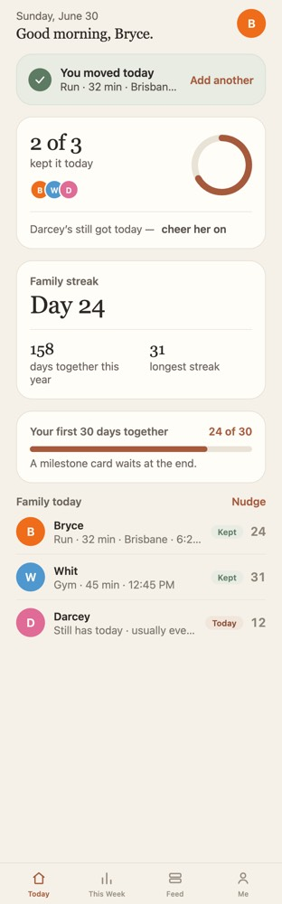
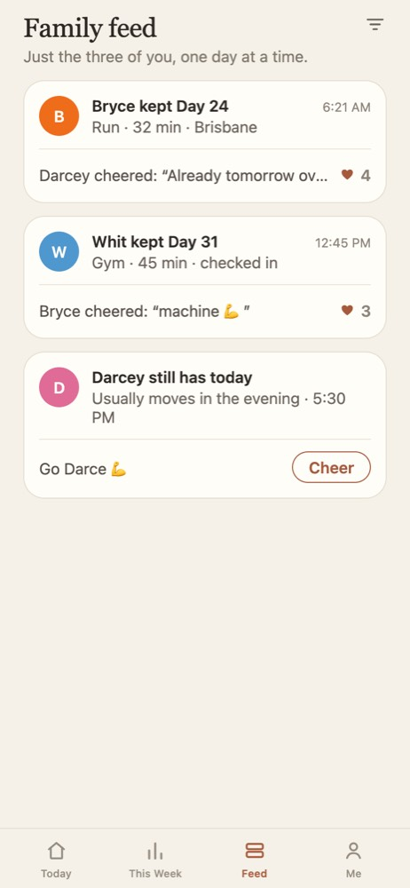

# Arro

**Status: parked.** Arro isn't maintained anymore. It got as far as
TestFlight in October 2026 and never went on the App Store. The code is here to
read, run and borrow from. Issues and pull requests probably won't get an answer.

Arro is a daily movement streak for families who live apart. Everyone moves a
little, everyone sees it, and the family keeps one streak together. Any workout
counts: a walk, the gym, yoga, a swim. A walk counts the same as a marathon.

It's meant to be one moment of contact a day, not a feed to scroll. So there
are no rankings, a missed day is never public ("Darcey still has today", never
"Darcey broke the streak"), and nudges are capped. Workouts come from Apple
Health or a manual "I moved today" check-in. It's iPhone only.

<p>
  
  
</p>

These two are design sketches from the web preview in October 2026 (direction A
in `design/visual-direction.md`), not phone screenshots. The shipped app is
close to them but not identical. The names are the built-in preview family.

## Stack

- **Expo SDK 57**, React Native 0.86, React 19, TypeScript (strict), React Navigation 7
- **Supabase**: Postgres with row level security, Storage for photos, pg_cron
  for the evening push, and three Deno edge functions (`send-push`,
  `delete-account`, `remove-member`)
- **Sign in with Apple** (`expo-apple-authentication`) is the only sign-in
- **Apple Health** through `@appeeky/expo-healthkit`, for workouts and routes
- **Push** through `expo-notifications`; the server sends with Expo's push service
- `react-native-svg` and `react-native-maps` for rings, icons and routes
- The landing page in `site/` is plain HTML on a Cloudflare Worker

The app talks to Supabase only through `src/state/backend.ts`.

## Run it

### Quick look, no server

```bash
npm install
npx expo start --web   # opens in a browser on the built-in preview family
```

With no Supabase settings a dev build runs on a family kept on the device, so
you can click through every screen. A release build without them refuses to
start ("This build can't reach Arro").

### On an iPhone, with your own Supabase project

You'll need a Mac with Xcode, an Apple Developer account (Sign in with Apple
and HealthKit both need one), the [Supabase CLI](https://supabase.com/docs/guides/cli),
and Docker if you want the local database.

1. **Make it yours in `app.json`.** Change `ios.bundleIdentifier` from
   `com.arrofamily.arro` to your own. Delete `owner` and
   `extra.eas.projectId`, which point at the original author's Expo account,
   then run `npx eas-cli init` to make your own. Keep a project id there: push
   registration in `src/state/notifications.ts` needs one.
2. **Create a Supabase project** and apply the schema:
   ```bash
   npx supabase link --project-ref <your-project-ref>
   npx supabase db push          # applies supabase/migrations in order
   ```
3. **Auth.** In the dashboard, turn on the Apple provider with your bundle id
   as the client id, and turn off email and phone sign-up. Arro only uses
   Sign in with Apple.
4. **Edge functions.**
   ```bash
   npx supabase functions deploy send-push
   npx supabase functions deploy delete-account
   npx supabase functions deploy remove-member
   ```
   Their optional secrets (`EXPO_ACCESS_TOKEN`, and the four `APPLE_*` values
   for revoking an Apple token on account deletion) are listed in
   `.env.example`. Set them with `npx supabase secrets set NAME=value`.
5. **Vault secrets for pushes.** pg_cron calls `send-push` with two Vault
   secrets. In the SQL editor:
   ```sql
   select vault.create_secret('https://<your-project-ref>.supabase.co', 'project_url');
   select vault.create_secret('<your anon key>', 'anon_key');
   ```
   Without them, pushes stay queued and nothing else breaks.
6. **App settings.** Copy `.env.example` to `.env.local` and fill in
   `EXPO_PUBLIC_SUPABASE_URL` and `EXPO_PUBLIC_SUPABASE_ANON_KEY`. For EAS
   builds, set the same two as EAS environment variables, because EAS doesn't
   read `.env.local`.
7. **Run it.** HealthKit doesn't work in Expo Go, so use a dev build:
   ```bash
   npx expo run:ios
   ```

The anon key is meant to be public. Row level security in
`supabase/migrations/20261005000002_row_level_security.sql` and later
migrations keeps each family's data to its members, and the pgTAP tests check it.

## Tests

```bash
npm run typecheck                    # tsc --noEmit
npm test                             # Jest: dates, Health sync, the screens' view model
npx supabase db start                # local Postgres with every migration (needs Docker)
npx supabase test db                 # pgTAP: row level security, streaks, invites, pushes
DENO_NO_PACKAGE_JSON=1 deno check supabase/functions/*/index.ts
npx expo export --platform ios       # bundle check
```

GitHub Actions (`.github/workflows/ci.yml`) runs all of these except the
export on every pull request.

## Layout

```
App.tsx, index.ts     entry, providers, navigation, splash
src/state/            AppState, backend (every Supabase call), buildView, health, notifications
src/screens/          one file per screen; onboarding/ for first run
src/components/       shared UI (AvatarRing, StreakRing, WorkoutCard, TabBar...)
src/navigation/       RootNavigator, MainTabs, types
src/theme/            tokens, typography, motion
src/data/             types, the preview family, workout labels
supabase/migrations/  SQL migrations, applied in version order
supabase/tests/       pgTAP tests
supabase/functions/   edge functions, one folder each; _shared/ for helpers
site/                 the arrofamily.com landing page (Cloudflare Worker)
design/               product notes, research, App Store material
```

### Screens

| Screen | File | How to get there |
|---|---|---|
| Onboarding | `onboarding/*.tsx` | first launch: **Start a family** or **I have an invite** |
| Today | `TodayScreen.tsx` | **Today** tab |
| This Week | `ThisWeekScreen.tsx` | **This Week** tab |
| Feed | `FeedScreen.tsx` | **Feed** tab |
| Me | `ProfileScreen.tsx` | **Me** tab |
| Workout detail | `WorkoutDetailScreen.tsx` | tap a kept post in Feed, or a recent workout on Me |
| Nudge | `NudgeModalScreen.tsx` | **Nudge** on Today, or tap someone who still has today |
| Family members | `FamilyMembersScreen.tsx` | Settings, **Family members** |
| Settings | `SettingsScreen.tsx` | gear icon on Me |
| Milestone | `MilestoneScreen.tsx` | the 30-day badge on Me |

## Things that still point at the original project

- Settings links to the privacy and support pages on `arrofamily.com`
  (`src/screens/SettingsScreen.tsx`), and invite links use it too
  (`src/state/invite.ts`). Change both if you ship your own copy.
- `design/app-store/` is the original App Store and TestFlight material.
  It's useful as a checklist, but the account details in it are the
  original author's.
- `AGENTS.md` holds the working notes for the coding agents that built Arro.

## Read next

- `design/refactor-plan.md`: decisions and build phases
- `design/market-research.md`: competitors and the healthy-contact rules
- `design/visual-direction.md`: how the look was chosen
- `AUDIT.md`: the security and privacy check done before parking

## License

MIT, see `LICENSE`.
